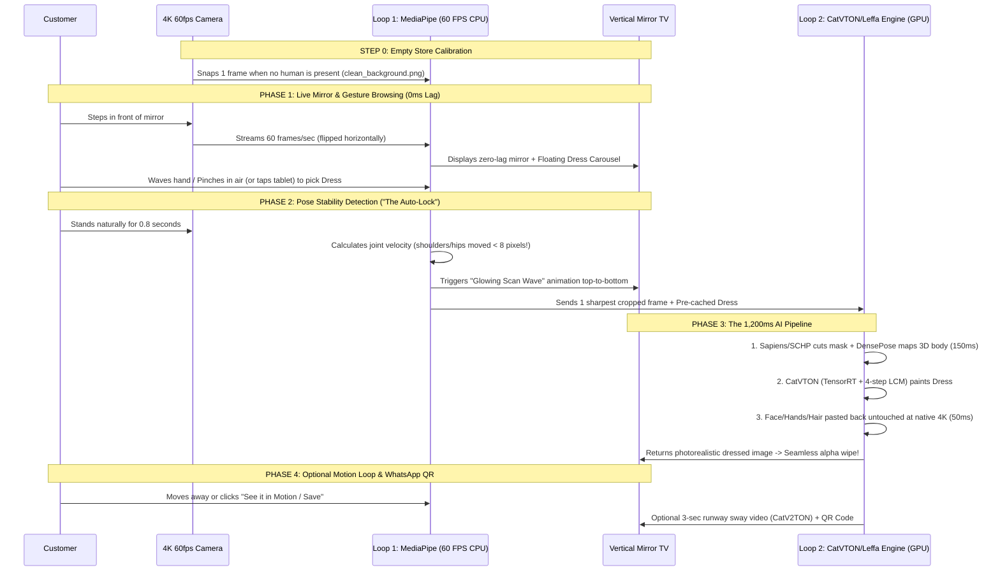

# Deep Dive: How the "Live Mirror + 1.5s Magic Lock" Architecture Works

This document breaks down every millisecond of how Architecture #1 works—from camera pixels to AI neural layers to the final TV mirror illusion.

---

## 1. The Core Secret: Why It Feels Like Real-Time Even Though AI Takes 1.5 Seconds

If you simply capture a frame, freeze the TV screen for 1.5 seconds while the AI thinks, and then pop an image onto the screen, **it feels like a cheap photo booth, NOT a magic mirror.**

To make the human brain believe it is looking into a magic mirror, we run **two parallel loops at the same time**:
- **Loop 1: The 60 FPS Reflex Loop (Runs on CPU in <10ms):** Keeps the mirror alive, tracks every finger and shoulder movement, and draws interactive glowing UI / ghost-dress alignment.
- **Loop 2: The 1.5s AI Materialization Loop (Runs on GPU asynchronously):** Secretly grabs the sharpest frame the moment the user stands still, dresses them in high definition, and **feathers/morphs** the AI dress onto their live reflection like a magical scan wave moving from shoulders to feet.

---

## 2. Step-by-Step Walkthrough (Millisecond by Millisecond)

---

## 3. Inside Each Technical Stage (How the Code & AI Actually Work)

### Stage 0: The "Clean Background" Trick (Before Anyone Walks In)
When the mirror detects **0 people** in front of it (`MediaPipe Pose` confidence = 0), it saves one frame to memory: `clean_background.png`.
- **Why?** Suppose a customer walks in wearing a wide winter jacket or baggy abaya, and selects a slim evening dress. When the AI removes their wide jacket, what is behind their waist? Because we saved `clean_background.png`, the AI knows *exactly* what the store shelves and floor tiles behind them look like!

### Stage 1: The 60 FPS Live Mirror + Air Gesture Control (`MediaPipe`)
1. OpenCV grabs the camera frame at `1920x1080` (portrait) @ 60 FPS and flips it horizontally (`cv2.flip(frame, 1)`).
2. Google's **`MediaPipe Holistic` / `BlazePose` + `Hands`** runs on the CPU in **~6 milliseconds per frame**.
3. It gives us `(x, y, z)` coordinates for:
   - **33 Body Joints** (shoulders, elbows, wrists, hips, knees, ankles).
   - **21 Hand Landmarks per hand** (fingertips, knuckles).
4. **How Air Swipe Works:**
   - We draw semi-transparent dress cards floating on the right edge of the TV screen.
   - When the customer's right index finger `(Landmark #8)` enters a card's box for 0.4 seconds (or pinches thumb `#4` + index `#8`), that dress is selected! No greasy fingerprints on the mirror glass.

### Stage 2: The "Auto-Stillness" Detector (No Buttons Needed!)
How does the mirror know *when* to trigger the AI without forcing the customer to press a "Take Photo" button?
- Every frame, we measure the **Euclidean distance** of 4 core body joints (`Left Shoulder`, `Right Shoulder`, `Left Hip`, `Right Hip`) compared to 15 frames ago (0.25 seconds ago):
  $$V_{motion} = \frac{1}{4}\sum_{i=1}^{4} \sqrt{(x_i^{(t)} - x_i^{(t-15)})^2 + (y_i^{(t)} - y_i^{(t-15)})^2}$$
- The moment $V_{motion}$ drops below a tiny threshold (the person naturally stopped moving to look at themselves in the mirror for ~0.7 seconds), **Auto-Lock fires automatically!**
- **Anti-Blur Check:** Out of the last 10 frames in the buffer, we compute the **Laplacian variance** (`cv2.Laplacian(frame, cv2.CV_64F).var()`) and pick the single sharpest frame with zero motion blur.

### Stage 3: The 150ms Anatomy Dissection (Preprocessing)
Now we have 1 crisp frame of the customer (`person.jpg`) and the selected dress (`dress_07.jpg`).
Note: `dress_07.jpg` was **already pre-processed when the store added it to the catalog**, so we pay **0ms** to process the dress!
For the customer's frame, three fast models run on the GPU in **~150 milliseconds total**:
1. **Bounding Box Crop:** We crop around the customer (`768 × 1024` pixels) so the AI doesn't waste time processing empty store walls on the left and right.
2. **Human Parsing (`Meta Sapiens-0.3B` or `SCHP` compiled in ONNX/TensorRT):**
   - Outputs a color-coded map of the person.
   - If the customer picked a **Full Dress**, our code masks out: `Upper-Clothes + Pants/Skirt + Torso Skin + Arms`, creating the **Agnostic Mask** (`mask.png`).
   - Crucially, it creates a **Protection Mask** for: `Face + Hair + Hands + Shoes + Jewelry/Glasses`. Those pixels are locked so the AI can *never* distort the customer's face!
3. **3D Body Map (`DensePose`):**
   - Converts the customer's body into a 3D UV map (`densepose.png`). Even though their old clothes were erased by the mask, `DensePose` tells the AI exactly where their shoulders, chest, waist, and arms are in 3D space.

### Stage 4: The 900ms AI Dress Synthesis (`CatVTON` / `Leffa`)
Now the magic happens inside **`CatVTON`** (or **`Leffa`**):
1. **Spatial Concatenation:**
   - Instead of complicated dual networks, `CatVTON` literally places the **Masked Customer** on the left half and the **Clean Store Dress** on the right half of a single canvas:
     - Input Tensor Width = `768 + 768 = 1536`, Height = `1024`.
2. **Self-Attention Across the Canvas:**
   - Because both images sit side-by-side inside the same U-Net, the neural network's **Self-Attention layers** look at the dress on the right (its gold buttons, floral print, neckline, fabric sheen) and copy those exact textures over to the customer's 3D `DensePose` body on the left—bending the fabric to match their pose and store lighting!
3. **How We Cut Inference from 8 Seconds Down to ~0.9 Seconds:**
   - **Trick 1 — Garment KV-Caching:** The right half of the canvas (Dress #7) doesn't change! We pre-compute its VAE latents before the customer even stops moving.
   - **Trick 2 — LCM / Hyper-SD Distillation (4 Steps instead of 30 Steps):** Normal diffusion denoises an image over 30 slow steps. By plugging in a **Latent Consistency LoRA (`LCM-LoRA` / `Hyper-SD`)**, the model finishes denoising in just **4 steps** (cutting time by 7x!).
   - **Trick 3 — `torch.compile` / NVIDIA TensorRT FP16:** Compiling the U-Net into a static TensorRT engine doubles the speed of each step.

### Stage 5: The 50ms "Zero-Hallucination" Compositing & Scan-Wave Reveal
Once `CatVTON` outputs the `768 × 1024` dressed customer:
1. **Pixel-Perfect Face & Hair Restoration:** We use the **Protection Mask** from Stage 3 with a soft 3-pixel Gaussian feather to paste the customer's *original, untouched 4K camera face, hair, and hands* directly on top. Their face remains 100% their real mirror reflection—never an AI face!
2. **The "Magic Scan Wave" UI Illusion:**
   - While those 1.2 seconds were happening, the TV screen didn't freeze! Instead, a glowing horizontal laser line (like a sci-fi scanner) swept smoothly from the top of the TV to the bottom over 1.2 seconds.
   - Above the laser line, the new AI-dressed image fades in; below the laser line is the live mirror. By the time the laser reaches their shoes (1.2 seconds later), the GPU has finished rendering and the full dressed reflection is revealed seamlessly!

### Stage 6: What Happens When the Customer Moves Again? (Two Modes)
- **Option 6A (Instant Resume + Side-by-Side):** The moment the customer moves their body again ($V_{motion} > \text{threshold}$), the main mirror smoothly unlocks back to 60 FPS live view, while pinning their dressed HD photo in a comparison card on the side of the mirror (so they can compare Dress #7, Dress #8, and Dress #9 side-by-side!).
- **Option 6B ("Bring to Life" 3-Sec Video Loop):** If they tap *"Animate"* (or hold the pose for 2 more seconds), **`CatV2TON` / `ViViD`** generates a 3-second moving video of them turning/swaying in the dress, accompanied by a **QR code** to download it straight to their phone.
