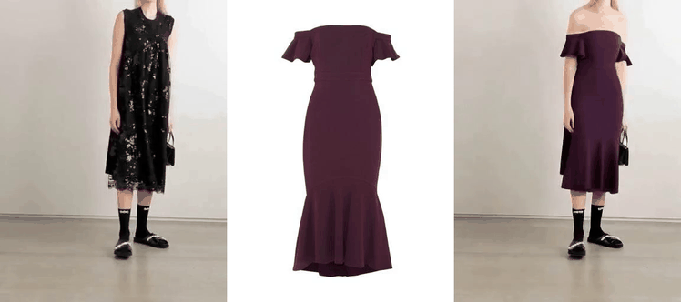
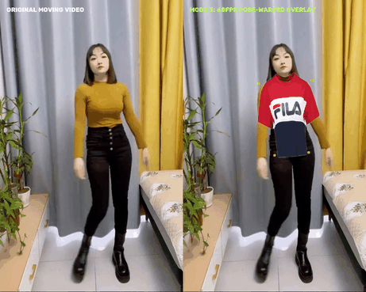

# Siraj — Moving Video Virtual Try-On (Mode #2 vs Mode #3)

Focused exclusively on **Moving Video Virtual Try-On** (no still-photo freezing).

---

## 1. Mode #2: AI Video Diffusion (`ViViD` / `CatV2TON`)
* **How it works:** Uses `DensePose` 3D surface video + `SAM` agnostic mask video + Spatio-Temporal Diffusion (`ViViD`) to synthesize photorealistic moving fabric folds across frames.
* **Pros:** 100% photorealistic fabric flow, lighting, and turns.
* **Cons:** Takes ~20–40 seconds on a 24GB GPU to render a 3-second video clip (not instant 0ms live mirror).

---

## 2. Mode #3: Live 60 FPS Pose-Tracked Cloth Warping (`MediaPipe` + Mesh Warping)
* **How it works:** Tracks 33 body landmarks (`Shoulders`, `Hips`, `Torso`) in `<6ms` per frame using `MediaPipe Pose` and warps the garment onto the moving body in real time at **60 FPS** (`0ms lag`).
* **Pros:** Instantaneous 60 FPS live mirror reflection on any CPU/MacBook.
* **Cons:** Looks like a 2D/2.5D AR overlay compared to Mode #2's photorealistic diffusion.

---

## Master Study Document
- [`VTON_Smart_Mirror_Master_Study.md`](VTON_Smart_Mirror_Master_Study.md) — Complete technical breakdown of **Mode #2 (`ViViD` / `CatV2TON`)** and **Mode #3 (60 FPS Pose-Tracked Cloth Warping & 3D Physics)**.
