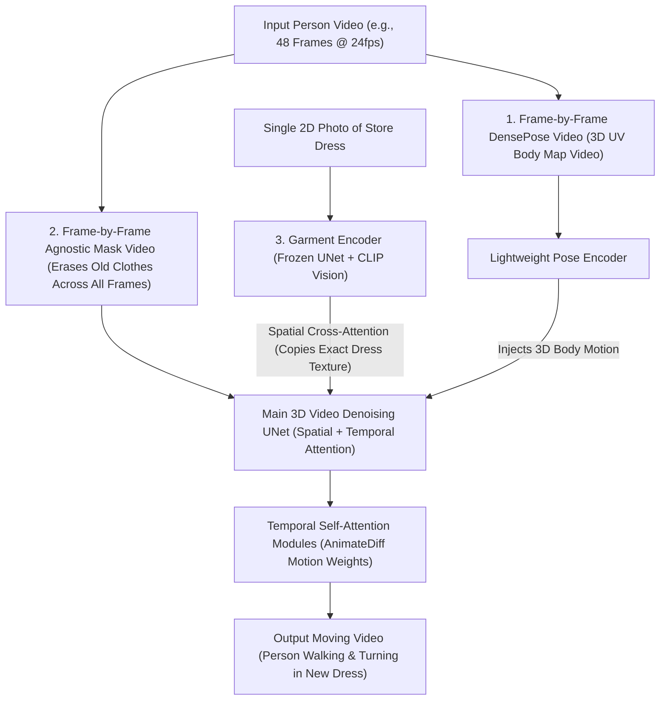

# AI Video Virtual Try-On (VVT) & Moving Smart Mirror Master Study

> **Objective:** Exhaustive technical, architectural, and dataset blueprint for **Moving Video Virtual Try-On** (where the dress moves naturally with the person across video frames, with zero still-photo freezing).

---

## 1. The Two Ways Moving Video Try-On Works

When a person walks, turns, and waves in front of a camera and the dress moves on their body as a continuous video, there are **only two ways** to achieve it:

| Approach | How It Works | Visual Realism | Speed / Latency | Open-Source Examples |
| :--- | :--- | :--- | :--- | :--- |
| **A. AI Video Diffusion (`ViViD` / `CatV2TON` / `Tunnel Try-on`)** *(How `official_vivid_dress_red.mp4` is made)* | Takes a video clip of a person moving (`N` frames) + 1 flat photo of a dress, and uses a **3D Spatio-Temporal Diffusion / DiT network** to synthesize all `N` video frames together so the dress flows, folds, and turns with the person. | **100% Photorealistic** (real fabric drape, shadows, lighting, and turns). | **Offline / Near-Live Batch:** Takes ~15–40 seconds on an A100/4090 GPU to generate a 2-to-4 second (48–96 frame) video clip. | `alibaba-yuanjing-aigclab/ViViD`, `Zheng-Chong/CatV2TON`, `WildVidFit` |
| **B. Real-Time 60 FPS Pose-Tracked Cloth Warping / 3D Physics** | Tracks the person's 3D skeleton (`SMPL-X` / `MediaPipe` / `DensePose`) at 60 FPS and uses **TPS/Optical-Flow Mesh Warping or 3D Cloth Physics** (plus optional real-time `StreamDiffusion` neural shading) to move the dress instantly with the body. | **High to Medium** (reacts at 0ms lag; 3D physics looks slightly like AR unless refined by a fast neural pass). | **True Live 30–60 FPS** (`<30ms` per frame). | `MediaPipe` + Thin-Plate-Spline (TPS) / Delaunay Mesh Warping, `Microsoft TRELLIS` 2D-to-3D + Cloth Physics |

---

## 2. How `ViViD` (`official_vivid_dress_red.mp4`) Works Under the Hood

Why can't you just run an image model on Frame 1, Frame 2, Frame 3... of a video?
Because each frame would invent slightly different wrinkles, hemlines, and textures—making the dress **flicker and boil violently** at 24 FPS.

**`ViViD` (Video Virtual Try-on using Diffusion Models — Alibaba Group)** solves this by processing **a whole block of video frames (e.g., 24 frames at once)** inside a 5D tensor `[Batch, Channels, Frames, Height, Width]`:

### The 5 Exact Steps Required to Generate a `ViViD` Video:

1. **Input 1 — The Raw Driving Video (`videos/upper1.mp4`):**
   - A video of the person walking, turning, or posing (`624 × 832` resolution at 24 FPS).
2. **Input 2 — The `DensePose` Video (`densepose/upper1.mp4`):**
   - Generated by running `Detectron2 DensePose` (`vid2densepose`) on every frame of the person video.
   - Even when the person spins sideways, `DensePose` color-codes the exact 3D surface of their chest, back, shoulders, hips, and legs.
3. **Input 3 — The `Agnostic Mask` Video (`agnostic_mask/upper1.mp4`):**
   - Generated using Human Parsing (`SCHP` / `Meta Sapiens` / `OOTDiffusion`) + `SAM (Segment Anything)` across every frame of the video.
   - It blacks out the person's old clothes in every frame while keeping their head, hair, hands, and room background untouched.
4. **Input 4 — The Single 2D Dress Image (`cloth/dress.jpg`) + Cloth Mask (`cloth_mask/dress.jpg`):**
   - Just **1 still photo** of the dress. You do NOT need a video of the dress!
5. **The Spatio-Temporal Diffusion Pass (`GarmentNet` + `TryOnNet` + `Temporal Attention`):**
   - **Spatial Attention** looks at the 1 still photo of the dress and copies its color, lace, buttons, and silhouette onto every frame.
   - **Temporal Attention (`mm_sd_v15_v2` motion module)** links Frame $t-1$, Frame $t$, and Frame $t+1$ along the time axis so that as the person turns their hips or swings their arms, the fabric pleats and skirt hemline swing smoothly with physics-like continuity!

---

## 3. Open-Source Video Virtual Try-On Models Compared

| Model | GitHub Repository | Core Innovation | VRAM Required | License |
| :--- | :--- | :--- | :--- | :--- |
| **ViViD** | `alibaba-yuanjing-aigclab/ViViD` | Dual-UNet + `DensePose` video stream + Temporal Attention modules. | ~24 GB (A10G / RTX 3090 / 4090) | **Apache-2.0 (Commercial Friendly!)** |
| **CatV2TON** | `Zheng-Chong/CatV2TON` | Video Diffusion Transformer (DiT) + Temporal Concatenation + Clip-Overlapping inference for long videos + 3D mask smoothing (`ViViD-S`). | ~16–24 GB | CC BY-NC-SA 4.0 |
| **Tunnel Try-on** | Alibaba / HUST | Crops a Kalman-filtered "Focus Tunnel" around the moving person so zooming in/out or walking around the mirror stays sharp. | ~24 GB | Research |
| **MuseV / MagicAnimate + VTON** | `TMElyralab/MuseV` | Uses a single reference dressed frame + Pose-to-Video temporal control. | ~12–16 GB | Apache-2.0 / MIT |

---

## 4. How to Run Moving Video Try-On for a Retail Store

When deploying **moving video** in a fashion store, you have two ways to deliver the video experience:

1. **The "3-Second Spin / Runway Video" Mode (`ViViD` / `CatV2TON`):**
   - Customer steps in front of the camera and does a slow 3-second turn or pose movement.
   - The server runs `DensePose` + `Sapiens Mask` + `ViViD` / `CatV2TON` on that 3-second video clip and plays back the **looping HD video of them moving and turning in the dress** on the TV mirror (just like `official_vivid_dress_red.mp4`).
2. **The "Zero-Lag 60 FPS Live Skeleton Warping" Mode (`MediaPipe Pose` + Mesh Warping):**
   - As the customer moves live in front of the webcam, `MediaPipe Pose` tracks their 33 3D body landmarks (`Left/Right Shoulder`, `Left/Right Hip`, `Elbows`, `Knees`, `Ankles`) at 60 FPS.
   - A 2D/3D triangulated garment mesh is dynamically warped (`Piecewise Affine / Thin-Plate Spline`) onto their live body coordinates every millisecond so the dress moves instantaneously with their reflection.
