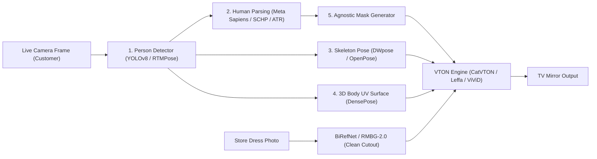

# AI Virtual Try-On (VTON) & Smart Mirror Master Research Study

> **Objective:** Exhaustive technical, architectural, dataset, and commercial blueprint for building and selling an AI Virtual Try-On Smart Mirror system to fashion retail outlets.

---

## 1. The Big Truth: What You Saw in the Reel vs. How It Actually Works

When you watch a viral reel of someone standing in front of a screen in a clothing store and magically swapping outfits in real time, **you are looking at one of two completely different technologies** (or a clever hybrid of both):

1. **The 3D Physics AR Illusion (What ZERO10, Snap AR, & FXMirror do at 60 FPS):**
   - It does **not** use generative AI to draw pixels frame-by-frame.
   - Instead, someone converted the dress into a **3D mesh** (like a video game skin in Unreal Engine / Lens Studio) with ragdoll cloth physics.
   - A depth/RGB camera tracks your 3D skeleton at 60 FPS and pins the 3D dress onto your body.
   - **Catch:** It moves instantly like a real mirror, *but* you cannot just feed it a flat photo of a dress from a local boutique. Every single dress needs a 3D model, and up close it slightly looks like a Snapchat filter.

2. **The Generative AI / Diffusion Approach (IDM-VTON, CatVTON, Leffa, ViViD, Kling/Wan):**
   - You give it a **single flat 2D photo** of any dress (even a complex sari, lehenga, or embroidered gown).
   - A Diffusion or Diffusion Transformer (DiT) neural network literally **erases your old clothes and paints the new dress onto your body**, matching your lighting, skin shadows, body curves, and fabric folds.
   - **Catch:** It looks 100% real (photorealistic), *but* generating 1 frame takes **0.3 to 6 seconds**, and generating a smooth 3-second video takes **10 to 45 seconds** on a heavy GPU.

---

## 2. Evolution of Virtual Try-On (Published Research History)

Understanding how the papers evolved explains why older repos fail and newer ones succeed:

### Era 1: 2D Warping + GANs (2018–2022) — *Fast, Blurry, Dead on Turns*
- **Key Papers:** `VITON` (2018), `CP-VTON` (2018), `VITON-HD` (2021), `HR-VITON` (2022), `GP-VTON` (2023), `FW-GAN` (Video, 2019), `ClothFormer` (Video, 2022).
- **How they worked:**
  1. **Warping Module:** Used Thin-Plate Splines (TPS) or Optical Flow (Appearance Flow) to stretch and bend the 2D flat image of the shirt/dress to match the person's torso shape.
  2. **Try-On Generator (GAN):** Blended the warped cloth onto the person.
- **Why they died:** If a person turned 30 degrees sideways or crossed their arms, the 2D warping tore the fabric into weird stretched soup.

### Era 2: Dual-UNet Latent Diffusion (2023–2024) — *Photorealistic, Heavy VRAM*
- **Key Papers:** `TryOnDiffusion` (Google, CVPR 2023), `LaDI-VTON` (2023), `StableVITON` (CVPR 2024), `OOTDiffusion` (2024), `IDM-VTON` (ECCV 2024).
- **How they worked:**
  - Built on Stable Diffusion (SD 1.5 or SDXL).
  - Used **two parallel U-Nets**:
    - `GarmentNet` (Reference UNet): Extracts every tiny texture, logo, and button from the flat dress image.
    - `TryOnNet` (Main Denoising UNet): Takes the masked person + pose map (`DensePose` / `OpenPose`) and fuses the features from `GarmentNet` via Self-Attention and Cross-Attention (`IP-Adapter`).
- **Pros:** Mind-blowing realism on single photos.
- **Cons:** Massive models (requires 16GB–24GB VRAM) and slow (20–30 denoising steps).

### Era 3: Lightweight Concatenation, Flow-Attention & DiTs (2024–2026) — *The Current State of the Art*
Researchers realized you don't need two giant U-Nets or text encoders (`CLIP`/`T5`) just to put a dress on a person.
- **`CatVTON` (ICLR 2025):** *"Concatenation Is All You Need."* Throws away the second UNet, throws away CLIP text encoders, and simply glues the person image and dress image side-by-side `[Person | Dress]` into a single lightweight inpainting UNet. Only 899M total parameters (<8GB VRAM!).
- **`Leffa` (CVPR 2025):** *"Learning Flow Fields in Attention."* Forces the diffusion attention layer to explicitly attend to the exact pixel region of the reference garment during training, fixing blurred logos and tiny embroidery patterns without slowing down inference.
- **`FitDiT` (2024/2025):** Uses a **Diffusion Transformer (SD3 / Flux style DiT)** instead of a U-Net, preserving ultra-fine garment stripes and text.
- **`CatVTON-Flux` / `FLUX.1 Fill` LoRAs (2025):** Combines Black Forest Labs' `FLUX.1-dev` / `FLUX.1-Fill` inpainting model with spatial concatenation `[Masked Person | Garment]`. Currently produces the highest visual fidelity in the open-source world, though heavier on compute.
- **Mask-Free VTON (`BooW-VTON`, `OmniTry`, `FitVTON` 2025–2026):** Eliminates the "agnostic mask" so the AI naturally handles putting a sleeveless dress over someone wearing a full-sleeve hoodie without hallucinating weird zombie arms.

---

## 3. Master Catalog of Open-Source Models (Image & Video)

### A. Image Virtual Try-On Models

| Model Name | GitHub Repo | Architecture | VRAM Needed | Speed (1 Frame, RTX 4090 / A100) | License | Verdict |
| :--- | :--- | :--- | :--- | :--- | :--- | :--- |
| **CatVTON** | `Zheng-Chong/CatVTON` | SD 1.5 Inpainting + Spatial Concat (899M params) | **~6–8 GB** | ~1.5s – 4s (with LCM/fewer steps) | CC BY-NC-SA 4.0 | **Best lightweight & fast model** for real-time hacking. |
| **Leffa** | `franciszzj/Leffa` | SD 1.5 / SDXL + Flow-Field Attention | ~12 GB | ~4s – 6s | **MIT** (Code/Weights*) | **Best open license** + super sharp textures. |
| **IDM-VTON** | `yisol/IDM-VTON` | SDXL Dual-UNet (`TryOnNet` + `GarmentNet` + `IP-Adapter`) | ~16–22 GB | ~8s – 12s | CC BY-NC-SA 4.0 | Classic high-res benchmark; too heavy for live video. |
| **OOTDiffusion** | `levihsu/OOTDiffusion` | SD 1.5 Dual-UNet (Upper, Lower, Full Dress) | ~12–16 GB | ~5s – 8s | MIT (Code) / NC (Data) | Good multi-part control (top + bottom separately). |
| **CatVTON-Flux** | `nftblackmagic/catvton-flux` | FLUX.1-Fill-dev + LoRA Spatial Concat | ~24 GB (or 12GB NF4/FP8) | ~10s – 20s (faster with Flux-Turbo) | Non-Commercial (Flux-dev) | **Highest realism** on complex ethnic/luxury dresses. |
| **FitDiT** | `BoyuanJiang/FitDiT` | Diffusion Transformer (DiT) | ~16–24 GB | ~6s – 10s | CC BY-NC-SA 4.0 | Exceptional on stripes, plaid, and printed text. |
| **GP-VTON** | `xiezhy6/GP-VTON` | Local-Flow Global-Parsing Warping GAN | **~4 GB** | **~0.08s (12+ FPS)** | Custom Research | Non-diffusion (GAN); ultra-fast, works only for front-facing poses. |

### B. Video Virtual Try-On (VVT) Models

If you apply an Image VTON model frame-by-frame to a 30 FPS video, the dress will **boil, flicker, and shimmer violently** because diffusion picks slightly different random details each frame. Video VTON models insert **Temporal Attention** modules across frames so the dress stays rock-solid as the person moves:

| Model Name | GitHub Repo | How It Works | Strengths & Limits |
| :--- | :--- | :--- | :--- |
| **ViViD** | `alibaba-yuanjing-aigclab/ViViD` | SD 1.5 + Garment Encoder + Pose Encoder (`DensePose`) + Temporal Modeling layers (AnimateDiff style). | **Apache-2.0 License!** Smooth motion, handles upper/lower/dresses. Takes ~15–30s to render a multi-second clip. |
| **CatV2TON** | `Zheng-Chong/CatV2TON` | Video Diffusion Transformer (DiT) + Temporal Concatenation + Overlapping Clip-Based Inference. | Handles long videos smoothly; lightweight compared to dual-UNet video models. |
| **Tunnel Try-on** | Paper / Alibaba & HUST | Crops a dynamic "Focus Tunnel" around the moving person using Kalman-filtered boxes and injects camera motion embeddings. | Keeps the person sharp even when walking closer/further from the mirror camera. |
| **MuseV / MagicAnimate + VTON** | `TMElyralab/MuseV` | Step 1: Use `CatVTON` / `Leffa` on **1 single frame** of the customer. Step 2: Use a fast Pose-to-Video model to animate that single frame matching the customer's movement. | Smart shortcut! Avoids running heavy try-on on every frame. |

---

## 4. The Hidden 70% of the System: Preprocessing & Masks

No VTON model works on raw camera pixels alone. Before the AI puts a dress on a customer, a **Preprocessing Pipeline** must dissect the camera frame in milliseconds:

### Every Preprocessing Tool You Must Know:
1. **Human Parsing (Pixel-by-Pixel Body Part Labels):**
   - Tells the system: *"Pixels (x,y) are hair, face, neck, left arm, shirt, pants, shoes."*
   - **Old Standard:** `SCHP` (Self-Correction for Human Parsing) & `Graphonomy` (trained on `LIP`, `ATR`, `CIHP` datasets — 18 to 20 body classes).
   - **New Gold Standard (2024–2026):** **Meta `Sapiens` (`Sapiens-Seg-0.3B` / `1B`)**. Trained by Meta on 300 million human images at native 1024×1024 resolution with 28 body-part classes. It cleanly separates hair strands falling over shoulders and fingers resting on the waist.
2. **2D Skeleton Pose (`DWpose` / `RTMPose`):**
   - Extracts body joints + 21 keypoints per hand + facial landmarks in <5ms using ONNX/TensorRT.
3. **3D Surface UV Mapping (`DensePose` via Detectron2):**
   - Maps every pixel of the customer's 2D body onto a 3D human mesh (`SMPL`). Without `DensePose`, the AI doesn't know if a person has a broad chest, curved waist, or twisted torso—the dress would look flat like cardboard.
4. **Garment Background Removal (`BiRefNet` or `BRIA RMBG-2.0`):**
   - When the store uploads a photo of a dress on a hanger or mannequin, `BiRefNet` strips the background and mannequin neck cleanly in 0.1s.

---

## 5. Every Published Dataset (And the Legal Trap!)

If you are building a commercial product to sell to fashion outlets, **this section can save your business from a lawsuit**.

### The Datasets Used to Train Open-Source VTON Models:

| Dataset Name | Content & Size | Resolution | Categories | License |
| :--- | :--- | :--- | :--- | :--- |
| **VITON-HD** (Zalando) | 13,679 frontal woman + top pairs | 1024 × 768 | Upper-body tops only | **Non-Commercial Only** |
| **DressCode** (YOOX Net-A-Porter) | 53,795 image pairs | 1024 × 768 | Upper, Lower, **Full Dresses** | **Strictly Non-Commercial Academic** |
| **SHHQ-1.0** | 40,000 full-body human images | 1024 × 512 | Full body humans | Non-Commercial Academic |
| **DeepFashion / DeepFashion2** | 800,000+ fashion photos | Various | Multi-category | **Non-Commercial Research** |
| **StreetTryOn** | In-the-wild street humans | Various | Casual street clothing | Research Only |
| **VVT (Video Virtual Try-On)** | 791 videos (661 train / 130 test) | 256 × 192 | Upper tops on runway walks | Research Only |
| **ViViD Dataset** (Alibaba) | **9,700 paired video clips + garments** | **832 × 624** | Upper, Lower, **Dresses** | **Apache-2.0 (Permissive)** |
| **ViViD-S** (CatV2TON) | Filtered & smoothed subset of ViViD | 832 × 624 | Upper, Lower, Dresses | CC BY-NC-SA 4.0 |

### ⚠️ The Commercial Licensing Trap (And How to Beat It)
- Almost all academic weights (`IDM-VTON`, `CatVTON`, `FitDiT`) were trained on `VITON-HD` and `DressCode`, which came from European fashion retailers (Zalando & YOOX) under **Non-Commercial** clauses.
- **How commercial startups legally deploy VTON:**
  1. Start with a **permissive base model** (e.g., `Stable Diffusion 1.5`, `SDXL`, `Wan2.1`, or `Qwen-Image` under Apache-2.0 / OpenRAIL, or `Leffa` / `ViViD` architecture code).
  2. Generate or collect your own paired training dataset! How? **Synthetic Reverse Masking:** Take 20,000 licensed/store videos or photos of models wearing dresses -> use `Sapiens` to segment the dress out -> use an LLM/diffusion model to flatten the dress into a clean "catalog flat-lay image". Now you have 100% commercially clean `(Person, Flat Dress, Person Wearing Dress)` triplets!

---

## 6. The 4 Hardest Technical Monsters (Failure Modes)

Every VTON system hits these 4 walls in the real world. Here is what they are and how to solve them:

### Monster #1: The "Abaya / Coat / Loose Clothes" Problem (Silhouette Mismatch)
- **What happens:** A customer walks into the store wearing a loose winter hoodie, wide jeans, or a baggy kurta/abaya, and tries to virtually wear a slim-fit sleeveless evening dress.
- **Why it fails:** If the mask only erases the hoodie, there is a massive empty hole wider than the customer's real body. The AI either makes the customer look 30kg heavier to fill the hoodie-shaped hole, or has to invent fake store background behind their waist.
- **Solution:**
  1. **Background Plate Caching:** Before the customer steps in front of the mirror, the camera snaps 1 empty frame of the store background (`clean_plate.png`). Now, whenever the AI needs to shrink bulky clothes down to a slim dress, it already knows the exact store floor/wall behind the person!
  2. **SMPL / DensePose Body Estimation:** Fit an under-clothing anatomical skeleton (`DensePose`) so the AI draws the slim dress to their real body width and fills the leftover gap with the cached `clean_plate.png`.

### Monster #2: The "Long Sleeve <-> Short Sleeve" Skin Hallucination
- **What happens:** Customer wears a full-sleeve shirt in the store and selects a sleeveless dress.
- **Why it fails:** The AI has never seen the customer's bare arms. It has to invent forearms and hands that match the exact skin tone of their face/neck.
- **Solution:** Sample the RGB/LAB color distribution of the customer's face/neck pixels (detected via `Sapiens`) and inject it into the inpainting mask conditioning so the generated arm skin tone matches seamlessly.

### Monster #3: Complex Ethnic & Flowing Garments (Sarees, Lehengas, Sheer Lace, Heavy Embroidery)
- **What happens:** Standard datasets (`VITON-HD`) were trained mostly on Western T-shirts and simple Western dresses. When given an Indian/Middle-Eastern gown, intricate gold Zari embroidery, or translucent chiffon sleeves, standard `SD 1.5` models blur the embroidery into spaghetti.
- **Solution:**
  1. Fine-tune a LoRA or `CatVTON` / `Leffa` checkpoint specifically on local store garments (takes only ~500–2,000 images on a single GPU).
  2. Use **High-Frequency Detail Injection (Detail-Preserving Warping / Sobel Edge Maps or `Leffa` attention flow)** so text, sequins, and embroidery patterns are copied almost pixel-for-pixel.

### Monster #4: The "Mirror Lag" Problem (Physics of Human Perception)
- **What happens:** When you look in a bathroom mirror and wave your hand, latency is **0 milliseconds**. If a digital TV mirror has even **300ms (0.3 seconds) of lag**, the human brain immediately stops feeling like it's a mirror and starts feeling like it's watching a delayed CCTV recording.
- **How to solve it:** See Section 7 below!

---

## 7. How to Architect the Smart Mirror for a Real Fashion Store

If you pitch this to a fashion outlet today, here are the **3 Proven Product Architectures** ranked by realism, latency, and engineering effort:

### Architecture 1: The "Dual-Mode Smart Mirror" (Live AR + Instant AI Studio Snap) — *Best ROI & Easiest to Sell First*
- **How the customer experiences it:**
  - **Mode A (Live 60 FPS Mirror):** The TV shows an instant, zero-lag 60 FPS mirror feed. A sleek floating carousel on the side lets them swipe dresses using **air hand gestures** (tracked via `MediaPipe Hands` — no smudging the TV screen!) or a small iPad stand next to the mirror.
  - **Fast Overlay Preview:** While moving at 60 FPS, a fast 2.5D warped/AR preview shows roughly how the dress color/cut sits on them.
  - **Mode B (1.5-Second AI Magic Lock):** When they pause for 1 second (or hold up a peace sign ✌), a glowing wave sweeps down the mirror and within **1.5 seconds**, `CatVTON` / `Leffa` (compiled with **TensorRT + LCM/Hyper-SD 4-step distillation**) renders a **100% photorealistic HD reflection** + optional **3-second moving runway loop** (`CatV2TON` / `ViViD`).
  - **WhatsApp / QR Viral Loop:** A QR code pops up in the corner so the customer downloads their try-on photo/video with the store's watermark to send to friends/family—giving the store free social media marketing!

### Architecture 2: True Real-Time Streaming Diffusion (12–20 FPS Live AI)
- **How it works under the hood:**
  1. Capture 1080p @ 60 FPS from camera.
  2. **ROI Bounding-Box Crop:** Do NOT run AI on the whole 1080p TV screen! Crop *only* the rectangle around the person's body (`512 × 384` or `768 × 576`).
  3. **Garment Feature Caching:** When the customer picks Dress #42, pre-compute the VAE latent and attention keys of Dress #42 **once** and lock them in GPU SRAM.
  4. **StreamDiffusion + TensorRT FP16 / FP8:** Run `CatVTON` distilled down to **2 to 4 denoising steps** using Latent Consistency Models (LCM) / Adversarial Diffusion Distillation (ADD) inside a batch-pipelined `StreamDiffusion` queue.
  5. **Optical Flow Temporal Smoothing (`RAFT` / `FastFlowNet`):** Blend adjacent frames using optical flow vectors so the fabric doesn't shimmer.
  6. Paste the rendered person back onto the live 60 FPS background feed and upscale via NVIDIA DLSS / TensorRT Super-Resolution.

### Architecture 3: Image-to-3D Garment Pipeline + Real-Time 60 FPS Physics (The ZERO10 Destroyer)
- **How it works:**
  1. **Offline (When the shop adds a new dress):** Take 1–4 photos of the dress -> run an open-source 2D-to-3D generator (`Microsoft TRELLIS`, `TripoSR`, `Unique3D`, or `Gaussian Garments`) to automatically build a rigged 3D garment mesh with PBR fabric textures in 30 seconds.
  2. **Online (Live at the Mirror):** Run 60 FPS 3D body tracking (`SMPL-X` / `MediaPipeBlazePose`) + real-time cloth physics (Unity / Unreal / Taichi) + a super lightweight 1-step neural shader pass to match store lighting.
  3. **Result:** True 60 FPS zero-lag movement even when spinning around!

---

## 8. Hardware Bill of Materials (BOM) for One Store Unit

What does it physically take to install one Smart Mirror kiosk in a fashion boutique?

| Component | Recommended Spec | Why It Matters | Approx Cost (USD) |
| :--- | :--- | :--- | :--- |
| **Display** | 55" or 65" 4K Commercial IPS/OLED Display (mounted 9:16 Portrait) + Optional Two-Way Dielectric Mirror Glass overlay | IPS/OLED prevents color shift at viewing angles; dielectric mirror glass makes it look like a real mirror even when black UI borders are shown. | $500 – $1,200 |
| **Camera** | Sony Starvis 4K 60fps USB3 Camera (or Orbbec Femto Bolt / Intel RealSense D455 for RGB + Depth) | Must have **Global Shutter or fast exposure** (no motion blur when customers move) and wide FOV (so customers can stand just 1.5–2 meters away). | $150 – $400 |
| **Lighting** | Vertical LED CRI 95+ Diffused Strip Lights along the mirror frame | **Crucial secret:** Bad store ceiling lights cast ugly shadows under eyes and confuse segmentation models. Built-in ring/frame lighting makes every customer look like a model. | $80 – $150 |
| **Compute (Option A: Local Edge Box)** | Compact Mini-ITX PC with **NVIDIA RTX 4090 (24GB)** or **RTX 4080 Super / 5080 (16GB)** | Zero internet lag; works even if store Wi-Fi goes down; zero monthly cloud GPU bill per frame. | $1,800 – $2,800 |
| **Compute (Option B: Cloud Streaming)** | Mini PC ($250) streaming WebRTC video to a cloud GPU server (L40S / A100 / H100) | Cheaper upfront hardware for the store, but requires fast fiber internet (<30ms ping) and charges per GPU hour. | $250 upfront + Cloud $/hr |
| **Control Interface** | Either Infrared Touch Frame overlay on the TV, a 10" tablet stand next to the mirror, or contactless Hand-Gesture UI (`MediaPipe`) | A tablet stand at waist height is often better than touching the big mirror (keeps the mirror glass clean of fingerprints and customers don't have to walk forward & backward!). | $100 – $250 |

---

## 9. How Store Catalog Onboarding Works (Making It Brain-Dead Simple for Shop Owners)

A fashion outlet will **reject** your product if adding 200 new dresses takes a PhD engineer. Your "Store Admin App" must work like this:
1. Store staff hangs a dress on a plain wall hook or white mannequin and snaps a photo on their phone.
2. Our automated ingestion pipeline runs automatically in 3 seconds:
   - `BiRefNet` removes the background & hanger/mannequin.
   - `Sapiens` / Garment classifier tags it automatically (`Full Dress` / `Top` / `Bottom` / `Outerwear`, sleeve length, neckline).
   - Pre-calculates and caches the garment embeddings (`VAE latents` + `CLIP/DINOv2` features).
3. Dress immediately appears on the Smart Mirror carousel with price, available sizes in stock, and fabric details.
